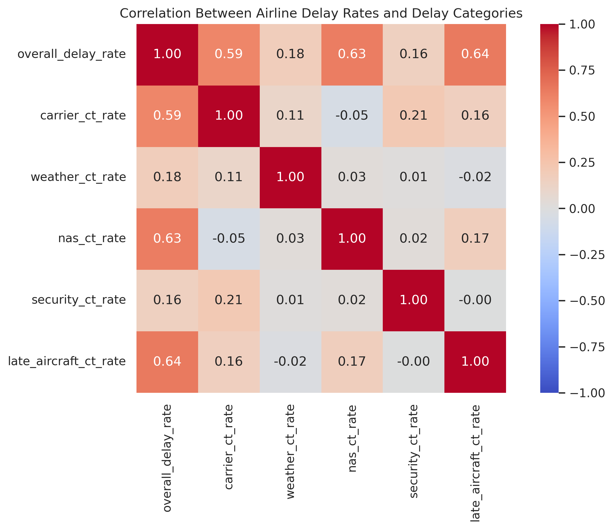
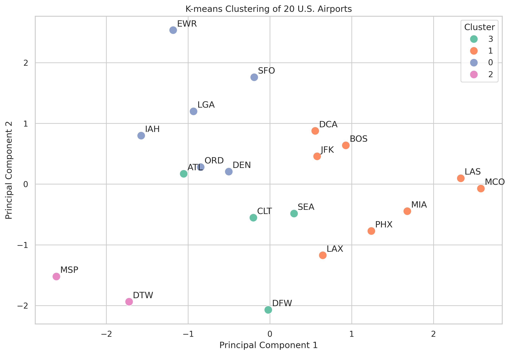
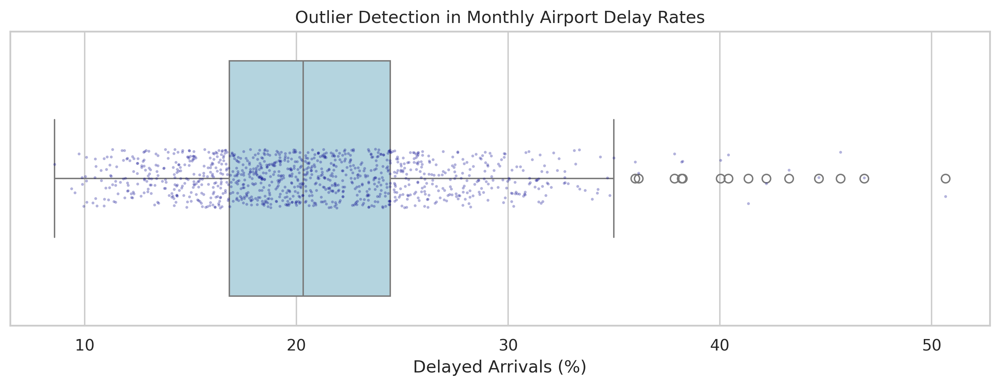

# U.S. Airline Delay Analysis (2022–2026)

Exploratory data analysis of airline arrival delays across **20 selected major U.S. airports**, using monthly [Bureau of Transportation Statistics (BTS)](https://www.transtats.bts.gov/) data from **January 2022 through July 2026**.

**Author:** Mahri Mammetmyradova  
**Project type:** Individual data analytics / Jupyter Notebook project

## Research question

> How do airline delay patterns differ across 20 major U.S. airports, and what relationships and unusual patterns can be identified from the data?

## Project highlights

- Examines monthly changes in arrival delay rates, including seasonal patterns.
- Compares airlines and airports using **flight-weighted delay percentages**.
- Visualizes reported delay minutes across carrier, weather, NAS, security, and late-aircraft categories.
- Uses **correlation analysis** to explore associations between delay categories and overall delay rates.
- Applies **K-means clustering** to standardized, airport-level delay-cause rates, selecting the cluster count using silhouette scores and visualizing clusters with PCA.
- Uses the **interquartile range (IQR)** method to identify unusually high or low airport-month delay rates.


## Key Visualizations & Findings

### 1. Correlation Analysis



**Figure 1. Correlation heatmap of airline delay rates and reported delay categories.**

Late-aircraft delay rates (r = 0.64), National Airspace System (NAS) delay rates (r = 0.63), and carrier delay rates (r = 0.59) showed the strongest positive correlations with overall delay rates. Because these categories contribute to the overall delay measure, the relationships are partly structural and do not demonstrate independent causal effects.

### 2. K-means Clustering of 20 U.S. Airports



**Figure 2. PCA visualization of four airport clusters identified using K-means.**

K-means clustering was used to group airports by similarities in their delay profiles. Four clusters were selected using silhouette-score comparisons. The silhouette score of approximately 0.257 suggests that the clusters are not strongly separated, so these groups are best interpreted as exploratory patterns rather than definitive airport categories.

### 3. Outlier Detection Using the IQR Method



**Figure 3. Distribution of monthly airport delay rates and observations flagged as outliers.**

The interquartile range (IQR) method was used to identify unusually high or low monthly airport delay rates. The analysis identified 14 unusual airport-month observations, including eight associated with San Francisco International Airport (SFO). These observations highlight periods that may warrant closer investigation; an outlier does not automatically indicate an error.

**Overall takeaway:** Airline delay patterns vary across airports and months. Correlation, clustering, and outlier detection provide complementary exploratory perspectives, but the findings do not establish causation or generalize automatically beyond the 20 selected airports.
  

## Methods and selected notebook findings

| Method | Purpose | Finding described in the notebook |
| --- | --- | --- |
| Trend and comparative visualizations | Compare seasonal, airline, and airport differences | Summer months frequently show elevated delay rates. |
| Correlation analysis | Compare delay-cause rates with overall delay rates | Positive associations were observed, especially for late-aircraft, NAS, and carrier delay rates. |
| K-means clustering | Group airports with similar delay profiles | Four groups were selected, though the silhouette score indicates weak separation. |
| IQR outlier detection | Flag unusual airport-month combinations | 14 unusual observations were identified, including 8 associated with SFO. |

**Interpretation notes:** The five cause-rate measures are components of the overall delay rate, so their correlations with the overall measure are partly structural and should not be interpreted as independent causal effects. The clustering and outlier findings are exploratory, not predictive or causal conclusions. The analysis is limited to the selected 20 airports.

## Tools

Python · pandas · NumPy · matplotlib · seaborn · scikit-learn · Jupyter Notebook · Excel

## Repository contents

```text
us-airline-delay-analysis/
├── Airline_Delay_Exploration.ipynb   # Full reproducible analysis workflow
├── requirements.txt                 # Python dependencies
├── README.md                        # Project overview and usage
├── DATASET_SETUP.md                 # Dataset requirements
└── .gitignore                       # Excludes local datasets and temporary files
```

## Getting started

1. Clone or download the repository.
2. From the project directory, create a Python virtual environment (optional but recommended):

   ```bash
   python -m venv .venv
   source .venv/bin/activate  # macOS/Linux
   # Windows: .venv\Scripts\activate
   ```

3. Install requirements:

   ```bash
   python -m pip install -r requirements.txt
   ```

4. Obtain the **previously cleaned project dataset** and save it as `BTS_top20_airline.xlsx` in the same folder as the notebook. See [DATASET_SETUP.md](DATASET_SETUP.md). This processed dataset is **not included** in this repository package. Downloading raw BTS data alone will not reproduce the same results without the original cleaning and filtering steps.
5. Open the notebook and run all cells from top to bottom:

   ```bash
   jupyter lab
   ```

**Reproducibility status:** The analysis depends on the cleaned Excel workbook listed above. The notebook and its saved outputs are included, but execution from a clean environment cannot be verified without that workbook.

## Data source

[Bureau of Transportation Statistics — TranStats](https://www.transtats.bts.gov/). The notebook analyzes a separately prepared subset from 20 selected airports. Refer to BTS for definitions of on-time performance and delay-cause variables.

## Next steps

- Investigate month-by-month seasonal differences and unusually high-delay periods.
- Examine airport differences within clusters.
- Evaluate explanatory patterns without equating correlation with causation.
